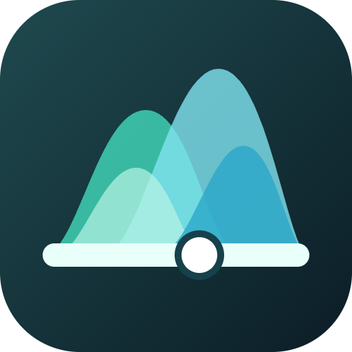
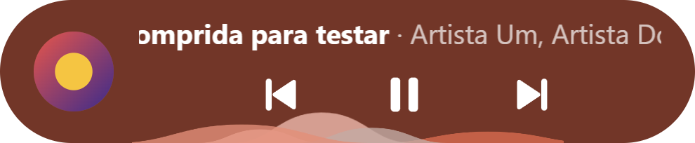

<div align="center">



# My Spoti Player

**Um mini player do Spotify que fica sempre à vista, com cores que mudam junto com a capa e ondas que dançam na barra de progresso.**

Electron · HTML, CSS e JS puro · sem frameworks · feito para Windows

</div>

<div align="center">


<br />



<sub>As capturas usam uma música e uma capa de exemplo.</sub>

</div>

---

## Por que existe

O app do Spotify é pesado e vive escondido atrás de outras janelas. O **My Spoti Player** é só o
controle: uma janelinha (ou uma pílula ainda menor) que fica por cima de tudo, bonita e leve. O
áudio continua tocando no Spotify oficial; este app conversa com ele pela Web API.

## Destaques

- 🎨 **Tema que vem da capa.** O app descobre a cor dominante da capa e pinta fundo, botões e
  ondas só com tons dela (mais claros ou mais escuros). Capa preto e branco? Tudo em cinza.
- 🌊 **Ondas vivas.** A barra de progresso e a base da tag têm morros translúcidos que nascem
  pequenos, crescem e somem, sempre da esquerda para a direita. Cada morro tem largura,
  altura, velocidade e cor próprias, e eles se sobrepõem como uma onda só.
- 💊 **Dois modos.** Janela normal (cartão grande da capa) ou **tag** em pílula, que dá para
  arrastar para qualquer lugar. Um clique na tag volta para a janela.
- 🪟 **Fundo borrado.** A janela normal usa o fundo acrílico do Windows 11: translúcido, mas
  sem deixar ver o que está atrás.
- ⚡ **Resposta imediata.** Play, pause, próxima, volume e curtir atualizam a tela na hora e
  corrigem sozinhos se a API discordar.
- 🔄 **Mostra a música certa logo ao abrir**, mesmo antes de dar play: lê o que o Spotify tem
  carregado pelo Windows e, se precisar, abre o Spotify por você.
- ❤️ **Curtir, aleatório, repetir, volume e copiar link** à mão, com ícones redondos e macios.
- 🔒 **Seus dados ficam com você.** O login usa OAuth com PKCE, sem guardar senha, e o token fica
  só no seu computador.

## O que você precisa

- Windows (a janela com fundo acrílico pede o Windows 11)
- [Node.js](https://nodejs.org) para instalar e rodar
- App do Spotify instalado
- Conta **Spotify Premium** (a Web API só deixa controlar a reprodução com Premium)

## macOS

No Mac o app controla o Spotify **localmente**, via AppleScript: não precisa de Client ID,
login nem Premium, e não tem limite de requisições. É só `npm install` e `npm start`.
Na primeira vez o macOS pergunta se o app pode controlar o Spotify: permita (ou em
Ajustes do Sistema > Privacidade e Segurança > Automação). Nesse modo o botão de curtir fica
desligado, porque curtir depende da conta (Web API). Os passos de Client ID abaixo valem
só para o Windows.

## Windows: uso da API

No Windows o estado do player (tocando, posição, música atual) e os controles de play, pause,
próxima, anterior e seek vêm da **sessão de mídia do sistema**, sem usar a API. A Web API só é
chamada uma vez por música (capa, volume, shuffle, repeat) e nos cliques de volume, curtir,
shuffle e repeat. Isso corta cerca de 95% das requisições e evita o limite do Spotify. Se a
sessão de mídia falhar, o app volta a usar só a API.

## Instalação

### 1. Criar o app no Spotify e pegar o Client ID

1. Acesse o [Developer Dashboard](https://developer.spotify.com/dashboard) e crie um app.
2. Em **Redirect URIs**, adicione exatamente: `http://127.0.0.1:8888/callback`
3. Copie o **Client ID** do app.

### 2. Configurar

```bash
cp config.example.json config.json
```

```json
{ "clientId": "seu_client_id_aqui" }
```

O `config.json` está no `.gitignore` e nunca vai para o Git.

### 3. Rodar

```bash
npm install
npm start
```

Na primeira vez, clique em **Entrar com Spotify**: o navegador abre, você autoriza e o app
guarda o refresh token localmente. Nas próximas execuções o login é automático.

### Abrir sem terminal

Dê dois cliques em `iniciar.vbs`, ou crie um atalho para ele na área de trabalho ou no menu
Iniciar (use `assets/icon.ico` como ícone). O app **não** abre sozinho com o Windows: você
escolhe quando começa e quando para (**×** ou **Sair** na bandeja).

## Como usar

| Ação                           | Como                                                                  |
| ------------------------------ | --------------------------------------------------------------------- |
| Mover a janela                 | Arraste por qualquer área livre (a posição é lembrada)                |
| Redimensionar                  | Pelas bordas da janela normal                                         |
| Ver os botões do topo          | Passe o mouse sobre a janela (modo mini, volume, copiar link, fechar) |
| Virar **tag**                  | Botão de modo mini no topo                                            |
| Voltar da tag para a janela    | Clique em qualquer área livre da tag                                  |
| Pular para um ponto da música  | Clique ou arraste na barra de progresso                               |
| Mostrar/ocultar ou sair do app | Ícone na bandeja do sistema (clique, ou botão direito para **Sair**)  |
| Fechar o app                   | **×** no topo da janela                                               |

## Personalizar o visual

Todo o visual está em [`src/renderer/style.css`](src/renderer/style.css). O bloco `:root` no topo
concentra cores, raios, fontes, tamanhos e durações (cada grupo está comentado) e o resto do
arquivo só usa essas variáveis.

- **Cores:** `--theme-bg`, `--theme-accent` e `--theme-wave-1..3` são trocadas a cada música a
  partir da capa. O que não vem da capa fica em `--color-*`.
- **Ondas:** `--wave-amp*` (altura) e `--pulse-*` (largura e transparência). A personalidade de
  cada morro (`--wide`, `--peak`, `--duration`, `--delay` e cor) fica nas regras
  `.pulse:nth-child(n)`.
- **Fundo da janela:** `--window-opacity` controla quanto da cor da capa cobre o fundo borrado.
- **Ícone do app:** edite `assets/icon.svg`; o `icon.png` e o `icon.ico` saem dele.

## Por dentro

```
src/main/       janela, bandeja, OAuth (PKCE), leitura do Spotify no Windows, IPC
src/preload/    ponte segura (contextBridge) exposta como window.api
src/renderer/   index.html, style.css, renderer.js, ui.js, palette.js, progress.js
src/shared/     Web API, estado da UI, formatação (sem Electron/DOM)
assets/         ícone do app
tests/          testes (Vitest)
docs/           guias do projeto (Git flow, estilo de código, testes)
```

Algumas decisões do projeto:

- **Sem frameworks nem dependências extras.** Só Electron; o resto é JS, HTML e CSS puros.
- **Lógica separada do Electron e do DOM** (`src/shared`, `palette.js`...), por isso é testada
  com facilidade.
- **Duas janelas, uma por modo.** A janela normal usa acrílico; a tag é transparente para ser
  uma pílula. Trocar de modo abre a janela certa e fecha a outra.
- **Se a tela travar,** ela se recarrega sozinha e o motivo vai para `debug.log`, na pasta de
  dados do app (`%APPDATA%\my-spoti-player`).

## Desenvolvimento

| Comando              | O que faz       |
| -------------------- | --------------- |
| `npm start`          | Roda o app      |
| `npm run lint`       | ESLint          |
| `npm run format`     | Prettier        |
| `npm test`           | Testes          |
| `npm run test:watch` | Testes em watch |

Antes de abrir um PR, rode `npm run lint` e `npm test`. Veja os guias em
[`docs/GIT_FLOW.md`](docs/GIT_FLOW.md), [`docs/CODE_STYLE.md`](docs/CODE_STYLE.md) e
[`docs/TESTING.md`](docs/TESTING.md).

## Limitações e próximos passos

- Hoje só funciona no **Windows**: a leitura da música carregada usa a sessão de mídia do
  Windows e o fundo borrado usa o acrílico do Windows 11.
- Suporte ao **macOS** é viável (o Electron é multiplataforma), mas pede trocar essas duas partes
  por equivalentes do Mac.
- Não existe versão para iOS ou Android.

---

<div align="center">
<sub>Projeto pessoal, feito com carinho e muitas ondas. O Spotify é marca de seus donos; este app não é afiliado a eles.</sub>
</div>
